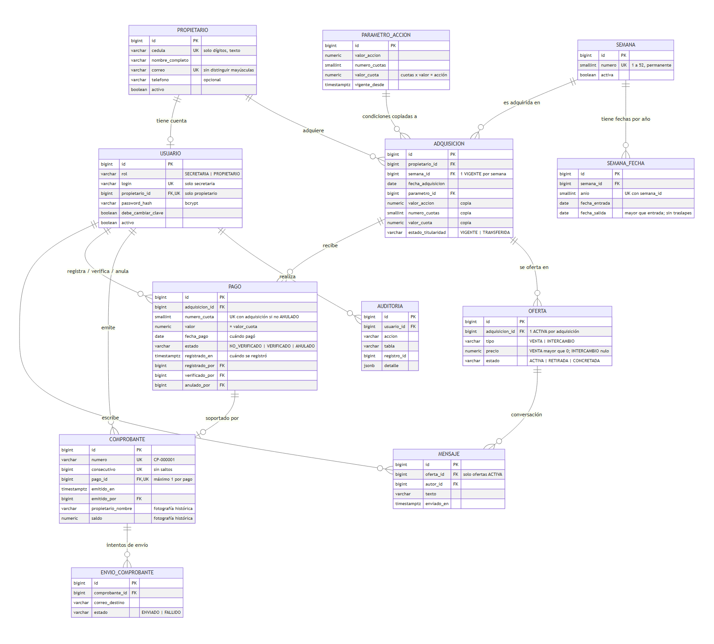
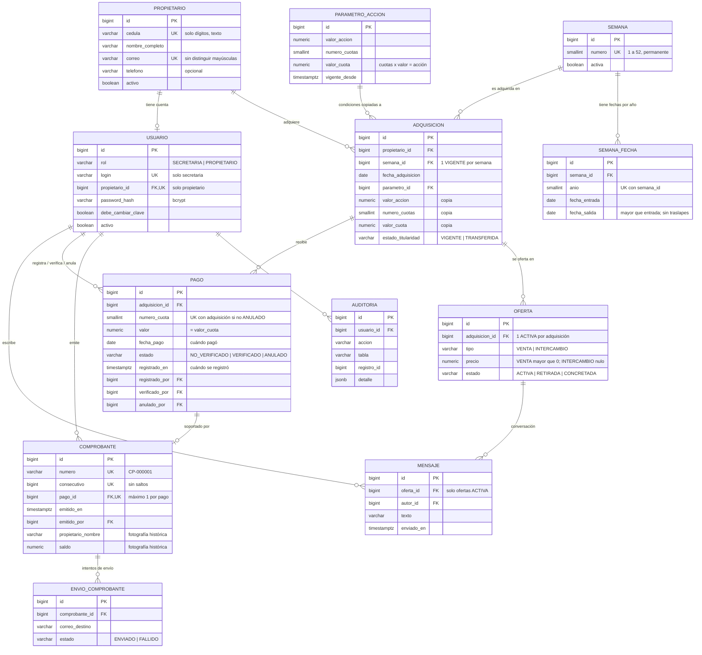

# Diagrama entidad-relación — CAM

Modelo implementado en PostgreSQL (esquema `cam`). Fuente: [`sql/02_tablas.sql`](../sql/02_tablas.sql).

> Imagen generada a partir del código Mermaid de abajo: [`diagrama_er.png`](diagrama_er.png) y, en alta calidad, [`diagrama_er.svg`](diagrama_er.svg) (se abre con el navegador). Se comprobó que cada columna del diagrama existe en la base `cam_db` (2026-11-03). Si cambia el modelo, el código Mermaid también se ve dibujado en GitHub o en VS Code (Ctrl+Shift+V con la extensión *Markdown Preview Mermaid Support*).

Tablas de apoyo que no aparecen en el diagrama: `consecutivo_comprobante` (contador de una sola fila para numerar comprobantes sin saltos) y `sesion` (sesiones de inicio de sesión del backend).

## Cómo leer las relaciones

| Símbolo | Significado |
|---|---|
| `\|\|--o{` | uno a muchos (puede haber cero) |
| `\|\|--o\|` | uno a cero o uno |
| PK | llave primaria |
| FK | llave foránea |
| UK | valor único |

## Reglas que el diagrama no muestra por sí solo

- **Un titular vigente por semana**: índice único parcial `adquisicion_titular_vigente_uq` sobre `semana_id` donde `estado_titularidad = 'VIGENTE'`.
- **Una cuota no se paga dos veces**: índice único parcial `pago_cuota_unica_uq` sobre `(adquisicion_id, numero_cuota)` donde `estado <> 'ANULADO'`.
- **La situación de pago no se guarda, se calcula** en la vista `v_estado_cuenta`. Solo los pagos verificados descuentan el saldo (decisión D2).
- **Inmutables**: `comprobante`, `parametro_accion` y `envio_comprobante` no se modifican. `pago` y `adquisicion` no se eliminan (triggers).
